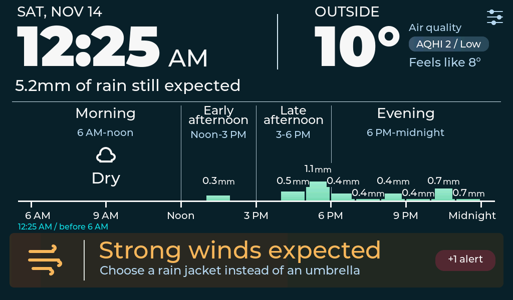

# Patio Weather Display

Dedicated native ESP-IDF/LVGL firmware for the **Waveshare ESP32-S3-Touch-LCD-7B**. The release targets the board's native 1024 x 600 landscape panel and is designed for an indoor, at-a-glance patio weather display.

The firmware is not a screenshot or browser shell. The dashboard, chart, icons, settings, keyboards, candidate lists, and warning banners are LVGL 8 objects drawn by the ESP32-S3.

[International release QA and screenshots](docs/international-qa.md)



The repository is public for inspection and release distribution. No license has yet been granted for the project's original source code. Third-party components retain the licenses listed in [THIRD_PARTY_NOTICES.md](THIRD_PARTY_NOTICES.md).

## What is implemented

- Large local clock/date, outside temperature, feels-like value, regional air-quality badge, settings affordance, and a single stable bottom advice banner.
- One proportional 6 AM-midnight forecast axis with 1/3, 1/6, 1/6, 1/3 day sections, a minute-updated time badge below the axis, individually dimmed elapsed rain bars, direct rain labels, and stable 3/6/12/24/48/96 mm scale steps.
- Open-Meteo current/hourly weather. Hourly liquid rain is `rain + showers` over the documented preceding `[T-3600,T)` interval. Snowfall remains separate; probability is never multiplied into an amount.
- ECCC Canadian AQHI with explicit nearest-community selection and source observation time. AQHI 10+ is preserved. High AQHI alone is described as poor air quality, not wildfire smoke.
- ECCC official alerts filtered with a geographic point intersection. Alert type, timing, IDs, impact, and feed-failure/cached-alert state are retained independently of weather and AQHI.
- Deterministic advice for dry, rain, heavy rain, strong wind, ice, snow, thunderstorm risk, heat, cold, poor air quality, high UV, unavailable weather, and applicable official alerts.
- Offline holiday calendars for Canada (federal, all provinces and territories), the US (federal, states, DC and selected cities), and South Korea. See [holiday coverage and sources](docs/holidays.md).
- First-boot Wi-Fi scan/select/password flow; city, postal/ZIP, and signed coordinate location modes; ambiguous-result selection; named-zone preview; and on-screen alphabetic/numeric keyboards.
- UTC/SNTP clock plus generated IANA zone transitions. It handles fractional offsets, 23/25-hour days, repeated/missing local hours, and BC's 2026 permanent UTC-07 rule for `America/Vancouver`.
- Two-slot, versioned, CRC-protected NVS settings; bounded CRC-protected SPIFFS source cache; independent source state/freshness; HTTPS certificate-bundle and hostname verification; bounded HTTP bodies and timeouts.
- Explicit development fixture mode, off by default, using the production models and renderer with the fixture indicator in Data & about.
- Headless native LVGL simulator that produces exact 1024 x 600 PNG screenshots.

## Proximity wake and screen timeout

The dashboard turns off after the selected idle time even without a sensor. Tap anywhere to restore normal reading brightness, even during scheduled dimming; the first tap only wakes the screen. An optional VL53L0X on the 7B I²C port wakes the dashboard at the distance you set under **Settings → Display & units → Wake distance** (30–200 cm in 10 cm steps; default 100 cm). Set **Settings → Display & units → Auto-turn off** (default: 1 minute). [Wiring, setup and a walk-up test](docs/proximity-setup.md).

Coordinates already confirmed on the device can be previewed offline. For a new location the worker waits for Wi-Fi and clock readiness and retries a temporary place-name or time-zone connection failure once.

## Verified target and pinned baseline

Target hardware:

- Waveshare **ESP32-S3-Touch-LCD-7B** only
- ESP32-S3-WROOM-1-N16R8: 16 MB flash, 8 MB octal PSRAM
- 7-inch 1024 x 600 RGB565 panel
- GT911 capacitive touch
- Waveshare board I/O expander at I2C address `0x24`
- CH343 USB-to-UART programming path

The board support is derived from Waveshare's `examples/ESP-IDF/13_lvgl_v8_demo` at vendor commit `c652c902db607f7ffb376257393cfd7657aa6428` (Apache-2.0). It preserves the documented panel timing, RGB pin map, GT911 reset ordering, expander power/reset lines, RGB bounce-buffer strategy, and inverted expander-PWM backlight control. No invented GPIO PWM is used.

Pinned software:

| Dependency | Pin |
|---|---|
| ESP-IDF | v5.5.2, source commit `30aaf64524299d3bde422ca9a2848090d1bc5d0f` |
| LVGL | 8.4.0 (`4495f428630cc1741bd8bfd977f080e8460e8e8d`) |
| `espressif/esp_lvgl_adapter` | 0.5.2 |
| `espressif/esp_lcd_touch_gt911` | 1.2.1 |
| Waveshare reference | `c652c902db607f7ffb376257393cfd7657aa6428` |
| IANA time-zone data | 2026f |

The firmware targets the documented 7B baseline. USB flashing and serial boot were verified on an attached board; its PCB revision has not been independently confirmed.

## Source layout

```text
components/
  board_waveshare_7b/  exact 7B display, touch, expander, backlight
  weather_core/        normalized models, rain math, advice, holidays, zones, fixtures
  services/            Open-Meteo, Nominatim, ECCC URLs and bounded parsers
  platform/            Wi-Fi, SNTP, HTTPS, NVS persistence
  cache/               bounded CRC-protected source cache
  ui/                  LVGL screens, native icons, subset display fonts
main/                   device runtime and task/queue integration
fixtures/               curated deterministic provider samples
host/                   unit tests and headless LVGL simulator
scripts/                reproducible font and IANA-zone generation
screenshots/            1024 x 600 simulator output
```

## Prerequisites

Use macOS or Linux with Git, CMake, Ninja, Python 3, and ESP-IDF v5.5.2. On macOS, install the CH343 driver only if the serial interface does not appear; current macOS versions may expose it without an extra driver.

Install ESP-IDF using Espressif's v5.5.2 instructions, then in each shell:

```sh
cd /path/to/esp-idf
git checkout v5.5.2
./install.sh esp32s3
. ./export.sh
```

## Build the real ESP32-S3 target

From this project directory:

```sh
idf.py set-target esp32s3
idf.py reconfigure
idf.py build
```

`sdkconfig.defaults` targets the documented 16 MB flash and 8 MB octal PSRAM,
plus the RGB565 LVGL setup, certificate bundle, three SNTP servers, custom
partition table, and display-stability settings inherited from the verified
baseline. The generated `flash_args` is authoritative for the boot-header
mode/frequency (`dout`/80 MHz in the verified build); do not hand-substitute
QIO flags or another 7-inch board's pin map.

The component manager resolves the exact versions in `main/idf_component.yml`. After a successful build, retain:

- `build/patio_weather_display.bin`
- `build/bootloader/bootloader.bin`
- `build/partition_table/partition-table.bin`
- `build/ota_data_initial.bin` when listed
- `build/flasher_args.json`, `build/flash_args`, and the build log/size report

The app binary is **not** a factory image and must never be written by itself at address zero.

The custom layout places the bootloader at `0x0`, partition table at `0x8000`,
OTA selection data at `0x11000`, and application at `0x30000`. Always use the
current build's generated manifest rather than copying these offsets into an
unrelated build.

This release includes a verified bundle under `firmware/`. Check it before
flashing:

```sh
cd firmware
shasum -a 256 -c SHA256SUMS.txt
```

`patio-weather-display-merged.bin` is the service image generated from the included `flash_args`. Its release-specific SHA-256 is in `firmware/SHA256SUMS.txt`.
The component binaries, debug ELF fingerprint, exact offsets, dependency pins, and hardware
status are recorded in `firmware/release-manifest.json`. The local ELF contains builder paths and is excluded from Git; the flashable images do not require it.

## Flash and monitor on macOS

Use the Type-C connector marked **USB TO UART** in the Waveshare documentation. Find the CH343 serial path:

```sh
ls /dev/cu.*
```

It commonly appears as `/dev/cu.wchusbserial*` or `/dev/cu.usbserial*`. Flash with the generated offsets and then open the monitor:

```sh
idf.py -p /dev/cu.wchusbserialXXXX flash monitor
```

Exit the serial monitor with `Ctrl-]`.

Normal flashing uses automatic download mode. If automatic entry fails:

1. Disconnect power/USB.
2. Hold **BOOT**.
3. Connect the USB-to-UART cable (or press RESET while BOOT remains held).
4. Release BOOT after the host sees the serial device.
5. Run the same `idf.py ... flash` command, then press RESET.

To make a single service image while preserving build-generated offsets:

```sh
esptool.py --chip esp32s3 merge_bin -o build/patio-weather-display-merged.bin @build/flash_args
```

Flash that merged image at zero only if it was generated from the same build's `flash_args`:

```sh
esptool.py --chip esp32s3 -p /dev/cu.wchusbserialXXXX write_flash 0x0 build/patio-weather-display-merged.bin
```

For the packaged release bundle, run the same command from `firmware/` with
`patio-weather-display-merged.bin` (without the `build/` prefix).

Prefer `idf.py flash`; it is harder to misuse.

## First boot and settings

With production fixture mode disabled, an unconfigured unit opens Wi-Fi setup:

1. Tap **Scan** if needed, then tap your network. For a secured network the
   keyboard opens across the bottom. Type the password and tap **Connect** above
   it. **ABC** switches case and **1#** opens numbers and symbols. Tap the
   password field to reopen the keyboard. **Other / hidden network** allows manual SSID entry
   and explicit security selection. Duplicate and unnamed scan entries are
   removed. Up to 20 unique networks are listed; manual entry remains available
   when a scan contains more.
2. After Wi-Fi connects, **Location & time** opens. On an unconfigured unit,
   once network time is synchronized, the firmware requests an approximate city
   and country from [IPWhois](https://ipwhois.io/documentation) over HTTPS.
   IPWhois sees the public IP of the connection; the device requests only city,
   country, country code and success status. It does not send Wi-Fi credentials.
   **Suggested from your network** is optional: tap it to fill the city fields. A VPN or hotspot
   may suggest another city. You can start entering a location immediately; a
   late or failed response leaves your entry alone. Reconnects do not repeat
   the request, and saved locations are never replaced by it.
3. On a new device, tap **Seoul City Hall** and then **Use this location** to use the [official main-building map pin](https://english.seoul.go.kr/city-hall/directions/1-seoul-city-hall-main-building-2/): **37.566685° N, 126.978419° E**, Asia/Seoul. This preset needs no geocoding request. To use another city, enter a country name or two-letter code and tap **Find location**. City, postal/ZIP and coordinates are separate search modes. A configured device always opens with its saved location.
4. Choose an explicit candidate. Review the resolved place, coordinates, named zone, current offset, seasonal-clock state, and holiday region.
5. Tap **Use this location** after checking the preview. The device saves the displayed coordinates and verified time zone locally, even if Wi-Fi has dropped since the search. The forecast and Canadian air-quality station lookup run separately.

A failed or cancelled lookup leaves the previous configuration intact. Location changes are staged so a new place name is not rendered with old weather. Wi-Fi credentials are retained by ESP-IDF Wi-Fi/NVS and are never logged by the application. Enable flash/NVS encryption in a production security configuration if the physical threat model requires encrypted-at-rest credentials.

The packaged configuration does not enable flash/NVS encryption. The Wi-Fi
screen therefore says credentials are stored on the device. Selecting a
secured network carries its minimum authentication requirement through to the
connection; it cannot silently join an open access point with the same name.
WEP and enterprise authentication are not supported by this setup flow.
After fast reconnect delays of 1, 2, 4, 8, 16 and 32 seconds, the device retries
every 3 minutes until it reconnects or you intentionally disconnect. Setup uses
the native touchscreen keyboard; this firmware does not provide a QR portal.

**Settings → Debug mode** shows live Wi-Fi signal in dBm, VL53L0X distance in millimetres, weather status and last fetch/error, clock synchronization, brightness, timeout, uptime and free memory. Opening it does not start a Wi-Fi scan or refresh the forecast.

Settings contains Location & time, Holidays, Air quality & alerts, Display & units, Wi-Fi, and Data & about. Celsius and millimetres are the required presentation. Brightness uses the board expander's inverted PWM register; scheduled dimming uses the selected location's named-zone local time.

## Live providers and policies

No paid backend or API key is required for the implemented BC path.

### Weather and location

- Weather: [Open-Meteo Forecast API](https://open-meteo.com/en/docs)
- City lookup: [Open-Meteo Geocoding API](https://open-meteo.com/en/docs/geocoding-api)
- Postal/reverse lookup: [OpenStreetMap Nominatim](https://nominatim.org/release-docs/latest/api/Overview/)

When a supported feed is stale or unavailable, a red warning triangle appears in the bottom banner. Tap **Retry data** to request an update immediately. If Wi-Fi is offline, the same button says **Scan Wi-Fi** and opens the network list. Alert text and the alert-count badge still open the bulletin.

Open-Meteo weather defaults to a 15-minute refresh and becomes materially stale after 3 hours. The request is bounded to the fields and horizon needed by this display. Model-based current conditions are described as such in Data & about; the board is not measuring outdoor temperature.

Nominatim is called only after an explicit user action, never for background
autocomplete. The last successful exact query is cached in bounded RAM for the
current boot, and requests are rate-limited to no more than one per second.
Before deployment, set `CONFIG_PATIO_HTTP_USER_AGENT` to an identifying product
name and contact URL/email that complies with the
[public Nominatim usage policy](https://operations.osmfoundation.org/policies/nominatim/).
OpenStreetMap attribution appears with candidate data and in Data & about.

### Canadian air quality and alerts

- [ECCC AQHI open data](https://eccc-msc.github.io/open-data/msc-data/aqhi/readme_aqhi_en/)
- [ECCC GeoMet alert data](https://eccc-msc.github.io/open-data/msc-data/alerts/readme_alerts-geomet_en/)

AQHI refreshes every 15 minutes and becomes stale when the source observation is older than 2 hours. The station/community collection is searched geographically and the nearest result is explicitly selected; response ordering is never trusted.

Selection is limited to 50 km by default, defined by
`kDefaultMaximumAqhiDistanceKm` in `components/services/include/weather/providers.hpp`;
the selection API also accepts an explicit maximum distance. This is a
conservative project policy, not
an ECCC guarantee that the community represents conditions at your exact
location. The community label includes its distance. Outside this limit, AQHI
is shown as unavailable instead of borrowing a distant reading.

When the dashboard would otherwise say “No umbrella needed,” it shows the highest-priority active official alert instead. The badge counts only other active alerts. The bottom banner uses one line of supporting text. Tap the alert banner to open its bulletin directly. Other active alerts appear below it. Back returns to the dashboard. Official alerts refresh every 5 minutes. A successful response replaces the active set after ID/update/expiry processing. A failed fetch does not mean "no alerts": still-valid cached alerts remain visible and the feed-error state is exposed. ECCC official alerts and AQHI are Canada-only. Outside Canada the dashboard instead requests **US AQI**, a regional model estimate from the Copernicus Atmosphere Monitoring Service (CAMS) via the [Open-Meteo Air Quality API](https://open-meteo.com/en/docs/air-quality-api). It uses the US scale, not each country’s official index or a local station observation. Data & about shows the model time and fetch time. A failed refresh marks the previous value stale, or unavailable if there is no reading.

Alert freshness is based on the last successful fetch, not an individual
alert's publication date; at the defaults the feed is marked stale after two
missed refresh periods (10 minutes). Source-cache writes are throttled to at
most once per 15 minutes and forced after a confirmed location change.

The AQHI worker resolves the Canadian station after the location is saved.
If ECCC is unreachable, air quality remains unavailable and the worker retries automatically. The nearest
community query is bounded to a ±2-degree search. Missing, null, zero, and
negative AQHI observations are rejected transactionally so an earlier valid
value can remain visible as stale.

Default refresh and staleness values can be changed with `menuconfig` without altering parser semantics.

## Advice rules

Convenience thresholds are application defaults, not official warning criteria:

| Rule | Default |
|---|---:|
| Umbrella minimum remaining liquid rain | 0.2 mm |
| Heavy hourly rain | 7.5 mm |
| Heavy remaining-day rain | 20.0 mm |
| Strong gust | 60 km/h |
| Heat apparent temperature | 35 C |
| Cold apparent temperature | -15 C |
| High UV | 6 |

Priority is deterministic: applicable official warnings/watches can override forecast-derived advice; then thunderstorm risk, ice, heat/cold, very high AQHI, strong wind, heavy rain, snow, routine rain, optional UV, and dry. Strong wind with rain recommends a rain jacket instead of an umbrella. Open-Meteo thunderstorm codes are phrased as forecast risk, not nearby detected lightning.

Remaining-day rain prorates a currently active provider hour by its elapsed fraction and marks the result approximate. This is an estimate from an hourly model interval, not exact minute-by-minute onset. A current dry interval does not make a later exact total approximate.

`Dry` / `No umbrella needed` requires complete liquid-rain fields across all
remaining forecast intervals. Mixed known-zero and missing intervals produce
an unavailable umbrella state; a known positive amount can still justify
taking an umbrella even if a later interval is incomplete.

## Time-zone and holiday data

`components/weather_core/src/tzdb_generated.cpp` is generated from IANA **tzdata 2026f**, SHA-256 `01b4a91cec5167ed48c11e8ab78f2048cead78ce94b0cafcad0ae8c5a3044d3d`. The embedded transition window is 2024-01-01 through 2037-12-31 and contains 597 named zones.

Compile the desired tzdata release with `zic`, then regenerate the committed
table from that compiled zoneinfo tree:

```sh
python3 scripts/generate_tzdb.py --version 2026f \
  /path/to/compiled-zoneinfo \
  components/weather_core/src/tzdb_generated.cpp
```

Review the generated version/hash constants and rerun the host tests. The tests specifically cover Vancouver's permanent UTC-07 in November 2026, Los Angeles missing/repeated hours and 23/25-hour days, and Kathmandu's UTC+05:45 offset.

The BC calendar is algorithmic and local. It covers the current/following year without Wi-Fi and separately stores name, date, jurisdiction, statutory/observance class, and configured day-off status. Revalidate calendar rules annually against the [BC statutory holiday source](https://www2.gov.bc.ca/gov/content/employment-business/employment-standards-advice/employment-standards/statutory-holidays).

## Fixture mode

Fixture mode is off by default. Enable it only for development:

```sh
idf.py menuconfig
# Patio weather display -> Development fixture mode
idf.py build flash monitor
```

The 27 selectable fixture names are documented in `main/Kconfig.projbuild`;
they include baseline, rain-passed, before-six, midnight, both holiday badge
styles, every advice state, negative temperature, extreme precipitation,
missing values, AQHI 10+, independent stale sources, multiple alerts, long
text, an active cached alert plus feed failure, and unsupported AQHI/alert
coverage. Fixture mode uses the same model, decisions, and LVGL renderer as
live operation and is visibly marked.

## Host tests

Core tests use ordinary CMake and do not require the device:

```sh
cmake -S host -B build-host -DPATIO_BUILD_SIMULATOR=OFF
cmake --build build-host --parallel
ctest --test-dir build-host --output-on-failure
```

To include the provider/parser fixture suite, point the host build at the cJSON source bundled with the pinned ESP-IDF:

```sh
cmake -S host -B build-host \
  -DPATIO_CJSON_SOURCE_DIR="$IDF_PATH/components/json/cJSON"
cmake --build build-host --parallel
ctest --test-dir build-host --output-on-failure
```

They cover interval-normalized liquid rain, partial-hour totals, mixed
missing/known rain fields, chart scale/NOW math, strict coordinates, BC and
federal holiday classification, all advice states, alert priority/expiry,
stale handling, invalid AQHI values, long text/feed-failure/unsupported
fixtures, Vancouver 2026, DST gaps/folds, fractional offsets, and 23/25-hour
local days.

Curated deterministic parser samples live under `fixtures/` and cover
Open-Meteo weather/geocoding/time-zone metadata, Nominatim postal/reverse
results, ECCC AQHI including 10+, ECCC alerts, and nearest AQHI community
selection. They are not preserved live responses; the alert sample is
synthetic. See `fixtures/README.md`.

Additional suites run production settings persistence and clock logic against
small host NVS/SNTP doubles, cache recovery against temporary files, and Wi-Fi
scan/retry/security policy. With `PATIO_BUILD_SIMULATOR=ON`, native LVGL event
tests exercise scrolling, selection, keyboard entry, hidden networks, chart
label bounds, negative-zero formatting and midnight invalidation. Host storage
fault injection verifies logical recovery, not physical flash timing.

## Screenshot of the connected dashboard

With firmware 1.0.17 or later, close the serial monitor and run
`python scripts/capture_display.py /dev/cu.wchusbserial…` in the ESP-IDF
Python environment (replace the port with the actual USB-to-UART port).
The command wakes the dashboard and saves a dated, full-resolution PNG to
Downloads. Optionally pass a destination filename as the second argument.
It copies the board's actual LVGL pixels and checks the transferred frame's
CRC. For another screenshot, run the same command without reflashing.

## Native LVGL simulator and screenshots

Point the host build at an LVGL 8.4.0 checkout, or let CMake fetch the pinned commit:

```sh
cmake -S host -B build-sim \
  -DPATIO_BUILD_SIMULATOR=ON \
  -DPATIO_LVGL_SOURCE_DIR=/path/to/lvgl-8.4.0
cmake --build build-sim --target patio_weather_simulator --parallel

./build-sim/patio_weather_simulator \
  --fixture baseline --screen home --output baseline.png
./build-sim/patio_weather_simulator \
  --fixture labour-day --screen home --output labour-day.png
./build-sim/patio_weather_simulator \
  --fixture baseline --screen settings --output settings.png
```

Valid screens are `home`, `settings`, `holidays`, `air`, `display`, `location`,
`location-ambiguous`, `wifi`, `wifi-crowded`, `wifi-manual`, and `details`.
Output is the same 1024 x 600 LVGL object tree used by
the firmware, rendered headlessly to PNG.

The final verified set is under `screenshots/fixtures/` (27 home
fixtures) and `screenshots/screens/` (11 screen modes); all 38 images are
1024 x 600.

## Memory and display stability

An RGB565 1024 x 600 framebuffer is 1,228,800 bytes; two are 2,457,600 bytes before LVGL/TLS/application allocations. The 7B BSP follows the pinned Waveshare/adapter path: RGB framebuffers live in PSRAM, adapter-selected buffering and a 10-line bounce buffer are used, and instruction/rodata XIP is enabled for network/display coexistence. Large clock/temperature glyphs are compressed Montserrat Black subsets rather than whole font files; icons are native LVGL draw primitives.

The bounded 128 KB LVGL allocator pool, LVGL task stack, large model snapshots,
and UI queue payload storage live in PSRAM. The adapter's 102,400-byte partial
draw buffer remains internal, following the pinned RGB driver path. Startup
logs the largest available internal block immediately before registration;
periodic diagnostics report worker/controller stack high-water marks and heap
space. A loading screen is rendered before SPIFFS may format its partition.

Target builds retain GCC `.su` stack-frame reports. Run the regression gate:

```sh
python3 scripts/check_stack_usage.py build
```

It rejects project frames over 4 KB and unbounded dynamic frames. It does not
prove a complete call-chain budget; device high-water measurements remain
required. Blocking HTTPS/parsing work runs outside LVGL callbacks and coherent
snapshots cross bounded FreeRTOS queues. Ordinary minute changes update only
clock/NOW; they do not rebuild the whole dashboard.

## Known limitations and device test procedure

- USB programming and boot were verified on hardware. The touch flow was exercised with coordinate input in LVGL. Sustained RGB stability and end-to-end radio association require physical confirmation.
- The documented 7B baseline is used, but the unit's physical PCB revision remains unverified.
- Air quality uses official AQHI in Canada and modelled US AQI elsewhere where data is available. Official alerts are Canada-only. See [holiday coverage](docs/holidays.md) for Canada, the US and South Korea. The UI and keyboard are English; try a romanized city name, country code, or coordinates when a name cannot be entered.
- The generated IANA transition window ends at 2038; update the data before then.
- Nominatim's public endpoint is appropriate only while its usage policy and this device's low, user-triggered request pattern remain compatible.
- Provider schemas/terms can change; the parsers fail transactionally rather than converting missing fields to zero, but representative live responses should be rechecked before long-term deployment.
- Native UI event tests and storage/SNTP doubles cover selected interactions,
  restart recovery and clock corrections. Real finger input, radio association,
  physical power cuts and live SNTP still require the device checklist.

After flashing, run this concrete device checklist:

1. Verify clean boot, 1024 x 600 orientation, no touch-axis swap, and a full-screen touch-target check.
2. Exercise backlight 0/25/80/100%, scheduled dimming, and warm/cold reboot.
3. Complete first-boot Wi-Fi/location, then reboot and confirm persistence/reconnect without logging the password.
4. Test city ambiguity, postal lookup, zero/negative coordinates, malformed input, Cancel, and failed lookup.
5. Leave the unit running for at least 24 hours while forcing fetches, Wi-Fi loss/recovery, DNS/TLS failures, and NVS writes; watch for RGB drift/tearing, watchdogs, leaks, or touch mismatch.
6. Cross local midnight and inspect date/holiday/chart coherence. If possible, use simulator/time injection for a DST gap/fold zone.
7. Confirm stale weather, stale AQHI, alert-feed failure with an active cached alert, AQHI 10+, and missing/null fields.
8. Compare provider timestamps and chart intervals against the Data & about screen and the raw API response.

The smallest remaining deployment action is to connect the actual 7B's **USB TO UART** port and run `idf.py -p <CH343-port> flash monitor`, then perform the checklist above.

## Attribution and licenses

- Weather/geocoding: Open-Meteo; follow its current attribution and usage terms.
- Map/geocoding data from Nominatim: © OpenStreetMap contributors, ODbL.
- Canadian AQHI and alerts: Environment and Climate Change Canada open data.
- Waveshare-derived board initialization: Apache-2.0.
- LVGL: MIT.
- ESP-IDF/cJSON and Espressif managed components: their included upstream licenses.
- Montserrat: SIL Open Font License 1.1.
- IANA time-zone database: public-domain/attribution terms in `third_party/licenses/IANA-tzdata.txt`.

See `THIRD_PARTY_NOTICES.md` and `third_party/licenses/`.
