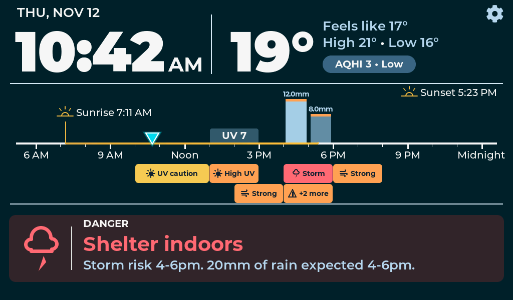

# Patio Weather Display 1.0.31

The space below the timeline now shows which weather hazards to expect and when. A snowflake with **Heavy** can appear from 2–3 PM while a wind symbol with **Strong** spans 2–5 PM. Tap either block for its time range and forecast measurements.

## Changes since v1.0.30

- The fixed **WIND** label is gone. Blocks can show wind, heavy rain or snow, UV, thunderstorms, hail, freezing precipitation, heat, or cold. Hourly precipitation amounts stay above the timeline.
- Two hazards can stack. When three or more coincide, the most severe stays visible; tap **+N more** to see the others for those hours. Yellow means caution, orange warning, and red danger. Official bulletins still open from the bottom banner.
- With UV advice enabled, moderate UV now gets a yellow **UV caution** block (index 3 to below 6 by default). Light wind alone leaves the strip hidden. A forecast refresh keeps the start time of an ongoing block; the block disappears when its window ends.

[Snow and wind together](https://github.com/fpenguin/patio-weather-display/blob/v1.0.31/screenshots/dashboard/snow-wind.png) · [What opens when you tap +2 more](https://github.com/fpenguin/patio-weather-display/blob/v1.0.31/screenshots/dashboard/mixed-alert-details.png)

## Which file to download

For the **Waveshare ESP32-S3-Touch-LCD-7B**:

| Use | Download |
| --- | --- |
| Update an existing installation and keep Wi-Fi and settings | [Application image](https://github.com/fpenguin/patio-weather-display/releases/download/v1.0.31/patio_weather_display-1.0.31.bin). On this project's partition layout, write to the active app slot: **`0x30000`** for the default `ota_0`. If you switched slots, confirm the active partition first. |
| Set up a new board or restore its flash layout | [Merged image](https://github.com/fpenguin/patio-weather-display/releases/download/v1.0.31/patio-weather-display-1.0.31-merged.bin) at **`0x0`**. This overwrites saved settings, including Wi-Fi credentials. |
| Get both images, flash instructions, screenshots, and notices | [Firmware ZIP](https://github.com/fpenguin/patio-weather-display/releases/download/v1.0.31/Patio-Weather-Display-1.0.31.zip). |

[SHA-256 checksums](https://github.com/fpenguin/patio-weather-display/releases/download/v1.0.31/SHA256SUMS.txt) · [Flash manifest](https://github.com/fpenguin/patio-weather-display/releases/download/v1.0.31/release-manifest.json) · [Build and test report](https://github.com/fpenguin/patio-weather-display/blob/v1.0.31/BUILD_REPORT.md)

All seven host suites passed (41 core cases), and the native simulator reproduced seven dashboard and detail previews byte for byte. The ESP32-S3 firmware passed image and partition checks. This version was not flashed to a physical board.
