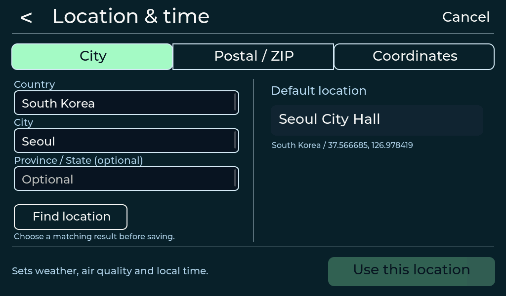
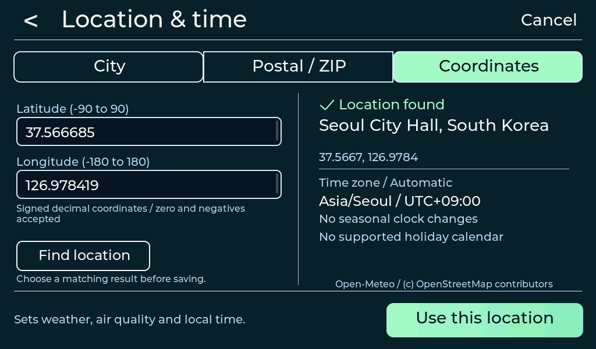
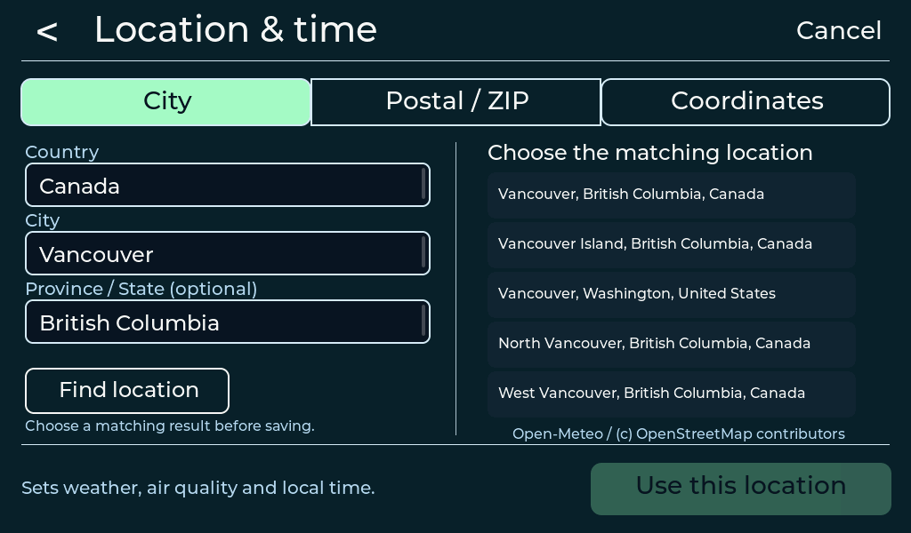
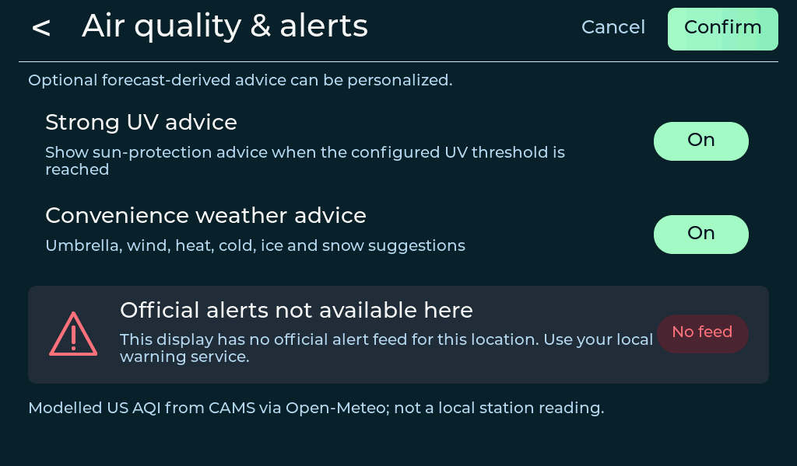
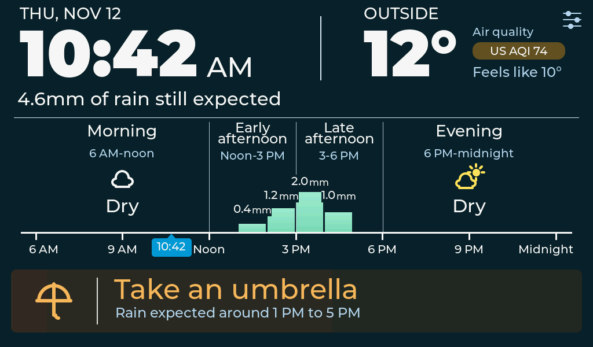
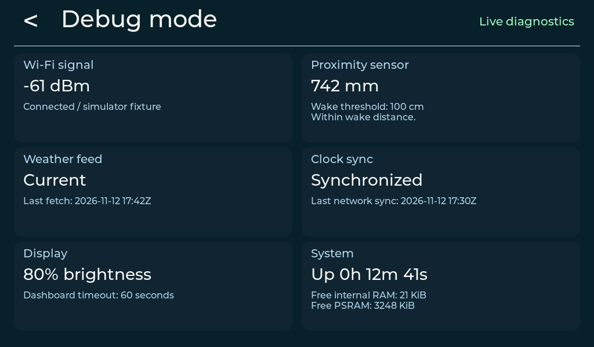
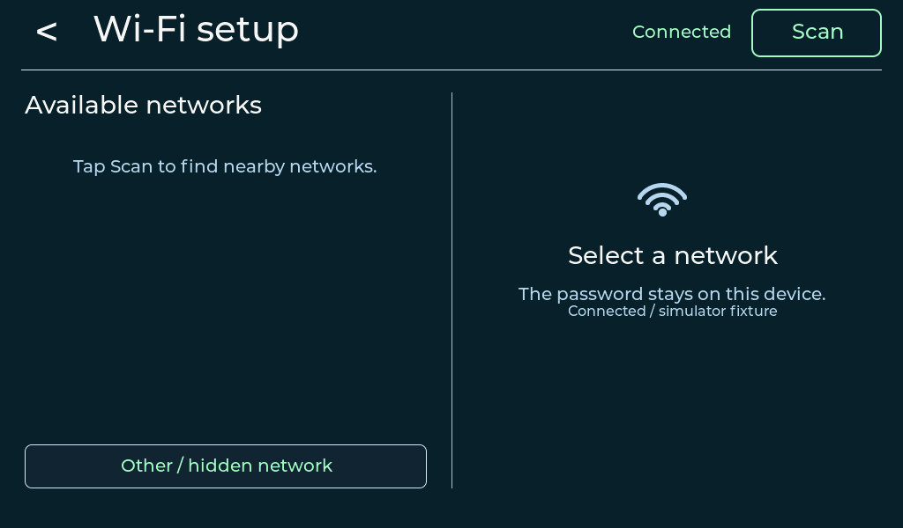
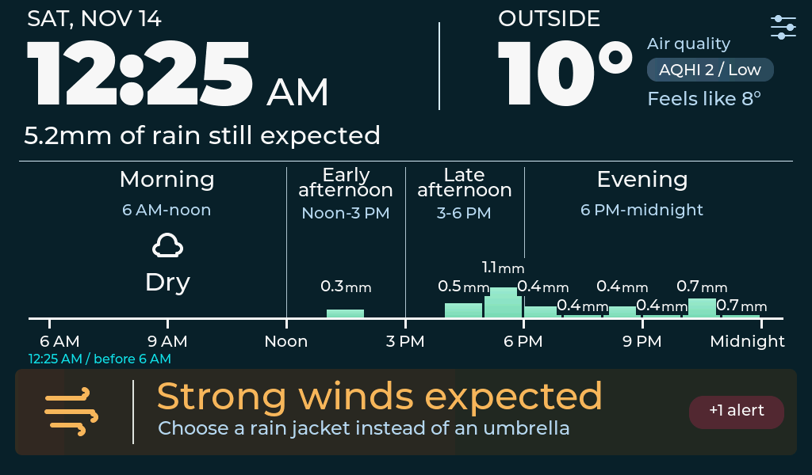

# International release QA · firmware 1.0.24

Tested 14 November 2026. A new device offers **Seoul City Hall**, 37.566685 N, 126.978419 E, Asia/Seoul, using the marker on the [city's main-building directions map](https://english.seoul.go.kr/city-hall/directions/1-seoul-city-hall-main-building-2/). Tap the preset, review the coordinates, then confirm. City search is a separate way to choose a city centre. A network hint is optional and never replaces the preset or a saved location.

## Live provider checks

These requests ran from the Mac using the firmware's URL builders, bounded JSON parsers, location validation, and embedded time-zone conversion. Each city passed country-filtered search, confirmed-location preparation, current temperature, hourly forecast spanning the test time, and the local UTC-offset check. All eleven non-Canadian points also returned a valid modelled US AQI. Vancouver uses the existing ECCC path; it was not counted as a modelled-AQI test.

| Cities | Returned local offsets at test time |
|---|---|
| Seoul, Tokyo | UTC+09:00 |
| Vancouver, New York, Honolulu | UTC−07:00, −05:00, −10:00 |
| London, Berlin | UTC+00:00, +01:00 |
| São Paulo, Nairobi | UTC−03:00, +03:00 |
| Kathmandu, Adelaide, Auckland | UTC+05:45, +10:30, +13:00 |

Two additional, user-style lookups used Nominatim plus Open-Meteo's coordinate time-zone endpoint: London postal code **SW1A 1AA** → GB / Europe/London; **−1.286389, 36.817223** → KE / Africa/Nairobi, keeping the entered point. These are samples, not a worldwide postal database test.

Re-run the optional city checks after configuring the host build with cJSON as described in the README:

```sh
cmake --build build-host --target world_city_probe
python3 scripts/check_world_cities.py build-host/world_city_probe
```

Requires internet and Python with IANA zoneinfo data. The seven ordinary host suites run offline. They include explicit preset confirmation, rejection of an edited/obsolete preview, network suggestion selection, saved-location preservation, and local-day bounds at DST changes. The target was built and flashed on the existing configured 7B; clean onboarding was verified in native LVGL without erasing that board. The individual cities were not tested on physical boards in those countries.

## Screenshots

All images are native 1024 × 600. Only the last image is a physical-board capture; all simulator readings and network suggestions are test data.

| First setup | Confirm the pinned coordinates |
|---|---|
|  |  |
| **Ambiguous city search** | **International alert and AQ coverage** |
|  |  |
| **Kathmandu dashboard fixture** | **Live diagnostics layout** |
|  |  |
| **Wi-Fi setup** | **Physical board after update** |
|  |  |

## Before distribution

- Canada has ECCC alerts and AQHI where covered. Elsewhere, US AQI is a CAMS model estimate, not an official local warning or a national index. In 1.0.24, holiday calendars were BC and Canadian federal only. See [current holiday coverage](holidays.md). The UI uses English, Latin keyboard input and metric units. Use a romanized name, two-letter country code or coordinates when needed. Captive portals and enterprise Wi-Fi were not validated.
- City setup, the Seoul preset, and normal forecast refreshes do not call Nominatim. Postal and reverse lookup currently use its hardcoded public endpoint. Per-device pacing cannot enforce the [service's aggregate traffic limit and provider-switch requirement](https://operations.osmfoundation.org/policies/nominatim/). Before distributing those features to many devices, use a switchable, rate-limited endpoint or another provider you operate. Review [Open-Meteo usage terms](https://open-meteo.com/en/terms) for your distribution.
- The tree has third-party notices but no top-level license for the project's original code. Choose one if you intend to grant reuse rights. Local work, logs, toolchains, private reference mockups and debug ELF are excluded by the root .gitignore. Review the staged files before publishing. No GitHub publication was performed by this QA run.
